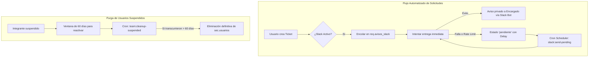

# Análisis Exhaustivo y Arquitectura Integral de SIGECO / NexusAdmin

**SIGECO (Sistema Integrado de Gestión Corporativa)** es una plataforma empresarial integral desarrollada para **100% Ingenieros**, diseñada para gestionar y coordinar la operación interdepartamental: administración de equipos y áreas de trabajo, mesa de ayuda interna y tickets de servicio, control y versionado de documentación institucional (SGC), y enlace de comunicación automatizado en tiempo real a través del bot corporativo de Slack y un asistente de enrutamiento con procesamiento de lenguaje natural local.

---

## 1. Visión General y Propósito del Software

El sistema resuelve la desconexión operativa entre áreas departamentales mediante los siguientes pilares:
1. **Mesa de Solicitudes y Tickets Inter-área**: Permite a cualquier miembro de un área enviar requerimientos estructurados con evidencias (archivos o enlaces Google Drive) a otra área (ej. compras a Administración, fallas o cronogramas a TI, piezas gráficas a Diseño, trámites a RRHH, facturas a Contabilidad).
2. **Notificaciones y Reintentos Automatizados en Slack**: Envío privado e instantáneo al encargado del área destinataria de cada ticket nuevo o redirigido, garantizando tiempos de respuesta.
3. **Asistente Inteligente de Clasificación**: Motor heurístico de NLP local que procesa la necesidad del usuario, sugiere el área idónea, la categoría, la prioridad y un título conciso sin transferir datos confidenciales al exterior.
4. **Gestión Documental y Versionado (SGC)**: Control de directivas, manuales, políticas y procedimientos por tipo de documento y área propietaria, con flujos de aprobación y vista previa de archivos.
5. **Gestión Descentralizada de Equipos**: Cada líder o encargado de área valida las solicitudes de registro de nuevos colaboradores, gestiona suspensiones (con purga programada a 60 días) y asigna identificadores de Slack.
6. **Gobierno y Módulos de Plataforma**: Rol `Plataforma_Admin` independiente que puede activar o desactivar en caliente la IA, la Gestión Documental y las Notificaciones de Slack sin afectar la integridad de los datos.

---

## 2. Stack Tecnológico y Arquitectura de Software

### 2.1 Backend (Laravel 12 / PHP 8.3)
El backend está estructurado bajo una **Arquitectura en Capas Unidireccional Limpia**, validada mediante pruebas automatizadas (`LayerArchitectureTest`):
- **Capa HTTP (`app/Http/`)**: Controladores RESTful (`Controllers/Api/`) y validación de entradas mediante FormRequests tipados (`Requests/`), con middleware de autenticación por tokens criptográficos (`api.token`), limitación de tasa (`throttle:login`, `throttle:registration`), control de roles (`role:*`) y feature flags (`module:*`).
- **Capa Business (`app/Business/`)**: Casos de uso y reglas de dominio puras (visibilidad horizontal y vertical de datos, transiciones permitidas, asistente de clasificación, notificaciones).
- **Capa Data (`app/Data/`)**: Separada en Contratos/Interfaces (`Data/Contracts/`) e implementaciones concretas en Eloquent/PostgreSQL (`Data/Eloquent/`), aislando la persistencia de la lógica de negocio.
- **Capa Domain (`app/Domain/`)**: Entidades organizadas por esquemas de base de datos (`Domain/Cfg`, `Domain/Sec`, `Domain/Org`, `Domain/Docs`, `Domain/Req`).

### 2.2 Frontend (React 19 / TypeScript / Vite)
- **Framework & Build**: React 19 con Vite y TypeScript estricto.
- **Estilos**: TailwindCSS y diseño moderno con tema oscuro/claro, modales interactivos y microanimaciones con Lucide Icons.
- **Estado y Caché**: `@tanstack/react-query` para sincronización de datos del servidor, revalidaciones automáticas e invalidación granular; `Zustand` para la persistencia del estado de sesión y credenciales.
- **Enrutamiento**: `react-router-dom` con envolturas de protección por autenticación (`RequireAuth`) y por roles (`RequireRole`).

---

## 3. Modelo y Estructura de la Base de Datos (PostgreSQL)

La base de datos utiliza una arquitectura basada en **6 esquemas lógicos** con **25 tablas operativas principales** y **42 relaciones foráneas formalmente indexadas**:

```
+---------------------------------------------------------------------------------+
|                                 ESQUEMAS POSTGRESQL                             |
+-------------------+--------------------+-------------------+--------------------+
|  cfg (Config)     |  sec (Seguridad)   |  org (Organismo)  |  docs (Documentos) |
+-------------------+--------------------+-------------------+--------------------+
| configuracion_    | usuarios           | areas             | tipos_documento    |
|   empresa         | roles              | miembros_area     | documentos         |
| historial_        | permisos           +-------------------+ versiones_         |
|   configuracion   | usuarios_roles     |  req (Requerimientos / Tickets)        |
|                   | roles_permisos     +----------------------------------------+
|                   | sesiones_usuario   | pedidos, detalles_pedido               |
|                   | tokens_acceso      | historial_pedido, adjuntos_pedido      |
|                   | intentos_login     | avisos_slack                           |
+-------------------+--------------------+----------------------------------------+
```

### 3.1 Tablas por Esquema Funcional

#### A. Esquema de Configuración (`cfg`)
1. **`cfg.configuracion_empresa`**: Fila única (`id=1`) con `nombre_empresa`, y banderas booleanas `ia_habilitada`, `documentos_habilitados`, `slack_habilitado`.
2. **`cfg.historial_configuracion`**: Auditoría inmutable de cada cambio en los módulos (`valores_anteriores` y `valores_nuevos` en formato JSONB, usuario ejecutor y marca temporal).

#### B. Esquema de Seguridad y Acceso (`sec`)
3. **`sec.usuarios`**: Credenciales hash (`password_hash`), nombre completo, correo único, estado (`pending`, `approved`, `suspended`, `rejected`), fecha de suspensión (`suspendido_en`), miembro de Slack (`slack_user_id`) y área vinculada.
4. **`sec.roles`**: Roles del sistema (`Plataforma_Admin`, `Administrador_Empresa`, `Super_Admin`, y pares `*_Encargado` y `*_Equipo` para cada área).
5. **`sec.permisos`**: Catálogo de capacidades granulares.
6. **`sec.usuarios_roles`**: Tabla pivote N:M entre usuarios y roles.
7. **`sec.roles_permisos`**: Tabla pivote N:M entre roles y permisos.
8. **`sec.tokens_acceso`**: Manejo de sesiones API basadas en tokens Bearer protegidos mediante resumen criptográfico SHA-256 (`hash_token`), con expiración y revocación.
9. **`sec.sesiones_usuario`**: Registro de conexiones, IPs y cadenas User-Agent.
10. **`sec.intentos_login`**: Registro de auditoría contra ataques de fuerza bruta (registra intentos con usuario o correos desconocidos).

#### C. Esquema Organizacional (`org`)
11. **`org.areas`**: Áreas activas de la empresa (`ADM`, `VENTAS`, `MKT`, `DIS`, `TI`, `RRHH`, `CONT`, `PSICO` y área de escalamiento `SUPER`).
12. **`org.miembros_area`**: Asignación de colaboradores a cada área con bandera booleana `es_encargado`.

#### D. Esquema de Documentación Institucional (`docs`)
13. **`docs.tipos_documento`**: Categorías normalizadas (`POL`: Política, `PRO`: Procedimiento, `INS`: Instructivo, `REG`: Registro, `MAN`: Manual, `FOR`: Formato).
14. **`docs.documentos`**: Registro maestro del documento, código correlativo generado automáticamente (ej. `POL-ADM-001`), título, estado (`Borrador`, `Vigente`, `Obsoleto`), área propietaria y versión actual.
15. **`docs.versiones_documento`**: Historial de cada versión (`numero_version`, `contenido`, `enlace_archivo` en disco local, motivo del cambio y autor).

#### E. Esquema de Solicitudes y Tickets (`req`)
16. **`req.pedidos`**: Tabla central de órdenes internas. Almacena `codigo_pedido` correlativo, `area_origen`, `area_destino`, `solicitado_por`, snapshot inmutable de `nombre_solicitante` y `correo_solicitante`, prioridad (`Baja`, `Media`, `Alta`, `Urgente`), estado, `atendido_por`, `respuesta`, fechas de escalamiento, atención y cierre.
17. **`req.detalles_pedido`**: Ítems, descripción, cantidades y unidades asociadas a un pedido.
18. **`req.historial_pedido`**: Bitácora inmutable de transiciones de estado, notas y usuario responsable.
19. **`req.adjuntos_pedido`**: Evidencias subidas directamente (PDF, DOCX, imágenes) o enlaces externos (Google Drive).
20. **`req.avisos_slack`**: Cola de notificaciones a Slack (`id_pedido`, `id_area_destino`, `destinatario_slack`, `estado` [pendiente, enviado, cancelado], `intentos`, `ultimo_error`, `proximo_intento`).

#### F. Esquema de Gestión de Activos, SLAs y Mantenimiento TI (`ti`) - 100% TechDesk
21. **`ti.activos`**: Catálogo e inventario maestro de hardware (laptops, monitores, servidores, periféricos). Control de código patrimonial, número de serie, especificaciones JSONB, estado operativo, condición física, costo y vida útil.
22. **`ti.asignaciones_activo`**: Trazabilidad dinámica de préstamos y devoluciones de equipos a colaboradores y áreas, vinculado opcionalmente al flujo de solicitudes de hardware (`req.pedidos`).
23. **`ti.mantenimientos_activo`**: Bitácora técnica y ficha histórica de mantenimientos preventivos y correctivos, fallas repetitivas, diagnóstico, piezas/repuestos reemplazados, técnico a cargo y costos.
24. **`ti.politicas_sla`**: Parámetros de Acuerdos de Nivel de Servicio por prioridad (Urgente, Alta, Media, Baja) y categoría, definiendo horas de primera respuesta y resolución.
25. **`ti.metricas_sla_pedido`**: Medición y cálculo algorítmico de tiempos de atención por orden/ticket, temporizadores en tiempo real, alertas de vencimiento e indicadores de cumplimiento.

---

## 4. Flujos Automatizados y Tareas Programadas

El software cuenta con varios flujos que operan automáticamente en segundo plano:



### 4.1 Notificaciones Automatizadas a Slack
- **Disparador**: Creación de una orden interna o escalamiento a Administrador de Empresa.
- **Lógica de Despacho**:
  1. Identifica al **único encargado activo** del área destinataria.
  2. Obtiene su identificador de Slack (`slack_user_id` formato `U...`).
  3. Ejecuta llamada API `conversations.open` para abrir un canal privado 1 a 1.
  4. Ejecuta `chat.postMessage` con los metadatos del ticket y enlace directo.
- **Resiliencia ante Fallos**:
  - Si Slack responde con error o código 429 (Rate Limit), respeta el header `Retry-After`.
  - El registro queda en estado `pendiente`.
  - El programador (`Schedule::command('slack:send-pending')->everyMinute()->withoutOverlapping()`) reintenta periódicamente los avisos vencidos.
  - Si el ticket cambia de área o se cierra antes de entregarse, el aviso se marca como `cancelado`.

### 4.2 Depuración y Purga de Miembros Suspendidos
- **Disparador**: Comando programado `team:cleanup-suspended`.
- **Lógica**: Inspecciona la tabla `sec.usuarios`. Si un miembro tiene estado `suspended` y su marca de tiempo `suspendido_en` supera los **60 días**, el sistema purga el registro permanentemente garantizando higiene en el directorio activo.

### 4.3 Clasificación Asistida de Tickets (Motor NLP Local)
- **Componente**: `TicketAssistantService` (`POST /api/v1/internal-orders/assist`).
- **Lógica**:
  1. Recibe la descripción redactada por el usuario y nombres de adjuntos.
  2. Normaliza el texto (minúsculas, remoción de tildes y diacríticos).
  3. Aplica un diccionario léxico ponderado con palabras clave por área:
     - **Diseño**: portadas, flyers, retoques, fotos de cursos, logos, afiches.
     - **TI**: web, cronogramas, correo, accesos, contraseña, bugs, caídas, laptops.
     - **Ventas**: prospectos, cotizaciones, leads, precios.
     - **Marketing**: campañas, pauta publicitaria, Facebook Ads, redes sociales.
     - **Recursos Humanos**: planillas, tardanzas, vacaciones, contratos.
     - **Contabilidad**: facturas, detracciones, SUNAT, boletas.
     - **Psicología**: salud mental, clima laboral, orientación, estrés.
     - **Administración**: compras, útiles de oficina, caja chica, proveedores.
  4. Pondera puntuaciones, detecta nivel de urgencia (`Urgente`, `Alta`, `Media`) y tipo (`Incidente`, `Acceso`, `Equipo`, `Software`, `Documentación`, `Servicio`).
  5. Si no hay ambigüedad, asigna el área automáticamente; si hay empate o duda, propone TI como fallback.
  6. **Privacidad garantizada**: Se ejecuta al 100% en el servidor local sin llamadas a modelos o APIs externas de pago.

### 4.4 Ciclo de Vida y Transiciones de Tickets
El flujo de estados sigue una máquina de estados finitos estricta:
1. `Enviado`: Emitido por el área solicitante.
2. `EnAtencion`: Tomado por un integrante o encargado del área destinataria (asigna `atendido_por`).
3. `Atendido`: El destinatario redacta la solución y adjunta evidencias.
4. `Rechazado`: El destinatario fundamenta el rechazo.
5. `Cerrado`: **Exclusivo del solicitante original**, quien valida la respuesta recibida y concluye formalmente el ciclo.
6. `Escalado`: **Privilegio exclusivo del área de TI**, que puede redirigir casos no resueltos hacia el Administrador de Empresa (`SUPER`).

---

## 5. Mapeo de Roles y Permisos (Matriz de Acceso)

| Rol | Alcance y Capacidades Operativas |
|---|---|
| **`Plataforma_Admin`** | Superadministrador de configuración técnica. Acceso exclusivo a `/plataforma`. Modifica el nombre de la empresa y habilita/deshabilita IA, Documentos y Slack. No ve tickets ni datos operativos. |
| **`Administrador_Empresa`** | Administrador corporativo. Supervisión global de todas las solicitudes (`/operacion`), gestión completa de áreas, usuarios y documentos institucionales. Resuelve tickets escalados. |
| **`*_Encargado`** | Líder de área departamental (ej. `TI_Encargado`, `Administracion_Encargado`). Supervisa la bandeja de su área, gestiona altas/bajas/suspensiones de su equipo, configura IDs de Slack y atiende requerimientos. |
| **`*_Equipo`** | Colaborador operativo del área (ej. `Ventas_Equipo`, `Diseno_Equipo`). Dispone de **Mi Panel** (solicitudes propias) y la bandeja de requerimientos dirigidos a su área para atenderlos. |

---

## 6. Modelado de Procesos BPMN y Scripts

En el directorio `docs/procesos_bpmn/` y `scripts/` se ubican herramientas de modelado de procesos según la especificación BPMN 2.0:
- **`scripts/build_process_models.py`**: Generador automático en Python que toma las definiciones de `scripts/area_models_data.py` y compila los esquemas XML BPMN y diagramas gráficos en PNG.
- **Procesos Mapeados**:
  1. `01_coordinacion_entre_areas`: Flujo transversal origen-destino.
  2. `02_administracion`: Ciclo documental y pedidos de insumos.
  3. `03_ventas`: Requerimientos de equipo y accesos comerciales.
  4. `04_marketing`: Solicitudes de recursos y herramientas de difusión.
  5. `05_tecnologia_ti`: Mesa de ayuda y escalamiento a gerencia.
  6. `06_recursos_humanos`: Aprobación y altas de cuentas de integrantes.
  7. `07_contabilidad`: Gestión de comprobantes y validación de software.
  8. `08_psicologia`: Atención y apoyo interno al colaborador.
  9. `09_ti_envia_pedidos_a_areas`: Solicitudes emitidas desde TI hacia departamentos.
  10. `10_asistente_de_tickets`: Algoritmo asistido de clasificación y derivación.

---

## 7. Automatización CI/CD y Herramientas CLI

- **GitHub Actions (`.github/workflows/quality.yml`)**:
  - Valida calidad de código backend (PHPStan / Pint / PHPUnit con cobertura sobre base PostgreSQL aislada `nexus_admin_test`).
  - Valida frontend (TypeScript `tsc --noEmit`, ESLint y build de producción con Vite).
- **Herramientas Artisan Propias (`backend/app/Console/Commands/`)**:
  - `php artisan platform:create-admin`: Creación segura e interactiva del administrador de plataforma.
  - `php artisan model:export`: Inspecciona las tablas reales de PostgreSQL y exporta los esquemas DBML actualizados sin volcar contraseñas ni datos sensibles.
  - `php artisan slack:send-pending`: Procesamiento manual o programado de reintentos de avisos a Slack.
  - `php artisan team:cleanup-suspended`: Depurador de cuentas suspendidas con más de 60 días de inactividad.

---

## 8. Resumen de Archivos Clave del Repositorio

- [DOCUMENTACION.md](file:///e:/ANOTHER/SIGECO-main/SIGECO-main/DOCUMENTACION.md): Especificación técnica del sistema y endpoints de API.
- [PLATAFORMA_Y_MODELO.md](file:///e:/ANOTHER/SIGECO-main/SIGECO-main/docs/PLATAFORMA_Y_MODELO.md): Guía de configuración modular y roles.
- [SLACK.md](file:///e:/ANOTHER/SIGECO-main/SIGECO-main/docs/SLACK.md): Instrucciones completas para el bot de Slack y variables de entorno.
- [ERD_SIGECO_Operativo.dbml](file:///e:/ANOTHER/SIGECO-main/SIGECO-main/database/ERD_SIGECO_Operativo.dbml): Diagrama entidad-relación de las 20 tablas activas en formato DBML.
- [InternalOrderService.php](file:///e:/ANOTHER/SIGECO-main/SIGECO-main/backend/app/Business/InternalOrders/InternalOrderService.php): Máquina de estados y reglas de negocio para los tickets.
- [TicketAssistantService.php](file:///e:/ANOTHER/SIGECO-main/SIGECO-main/backend/app/Business/InternalOrders/TicketAssistantService.php): Motor de procesamiento heurístico y clasificación de solicitudes.
- [SlackTicketService.php](file:///e:/ANOTHER/SIGECO-main/SIGECO-main/backend/app/Business/Notifications/SlackTicketService.php): Cliente de integración con la API de Slack.
- [App.tsx](file:///e:/ANOTHER/SIGECO-main/SIGECO-main/frontend/src/App.tsx): Definición de rutas y vistas protegidas del frontend.
- [FloatingAgent.tsx](file:///e:/ANOTHER/SIGECO-main/SIGECO-main/frontend/src/shared/FloatingAgent.tsx): Componente flotante de interfaz de usuario para el asistente interactivo de tickets.
